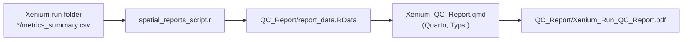

# Spatial-Reports

Generates a PDF QC report for a 10x Xenium run. For every region in the run it
summarises:

- cells detected
- total high-quality transcripts
- median genes per cell
- median transcripts per cell
- % of transcripts assigned to cells

It also flags regions whose metrics are more than 2 standard deviations from
the run mean, so they can be reviewed in Xenium Explorer.

## How it works



| File | Purpose |
|------|---------|
| `run_qc_report.sh` | Wrapper: activates renv, checks dependencies, runs the script, renders the PDF |
| `spatial_reports_script.r` | Finds every `metrics_summary.csv` in the run, builds the summary tables and outlier notes, saves `report_data.RData` |
| `Xenium_QC_Report.qmd` | Quarto template that loads `report_data.RData` and lays out the PDF |

The PDF is produced with Quarto's Typst output, so no LaTeX installation is
needed.

## Requirements

- R with an renv project containing `dplyr`, `readr`, `purrr`, `knitr` and
  `rmarkdown`
- Quarto 1.4 or later (the first version with Typst PDF output)

## Usage

```bash
./run_qc_report.sh /path/to/xenium/run_folder
```

For example, on NEMO:

```bash
RENV_PROJECT=/path/to/renv/project \
QUARTO_MODULE=<quarto module name> \
./run_qc_report.sh /nemo/stp/sequencing/inputs/instruments/xenium/10xdata/<run_folder>
```

Outputs are written to `<run_folder>/QC_Report/`:

- `report_data.RData`: the summary tables used by the report
- `Xenium_Run_QC_Report.pdf`: the report

### Settings

Set these as environment variables before running the wrapper. Both are
optional.

| Variable | Default | Meaning |
|----------|---------|---------|
| `RENV_PROJECT` | the folder containing the scripts | renv project folder; must contain `renv/activate.R` |
| `QUARTO_MODULE` | none | environment module to load if `quarto` is not on `PATH`, e.g. `Quarto/1.6.40` (see `module avail quarto`) |

If R only exists inside a container, run the wrapper from a shell inside that
container so `Rscript` is the container's R.

### What the wrapper checks

The wrapper stops with a clear message if any of these fail:

1. `Rscript` is on `PATH`
2. `quarto` is on `PATH` (loading `QUARTO_MODULE` if needed) and is version 1.4 or later
3. `RENV_PROJECT` contains `renv/activate.R`
4. All required R packages are installed in the renv environment; if not, it
   prints the `renv::install(...)` command to fix it
5. The script wrote `report_data.RData`
6. Quarto produced the PDF

## Running the steps by hand

Collect the metrics (the run folder argument is optional and overrides the
default path in the script):

```bash
Rscript spatial_reports_script.r /path/to/xenium/run_folder
```

Then render the report, passing the saved data file:

```bash
quarto render Xenium_QC_Report.qmd --to typst \
  -P data_file:/path/to/xenium/run_folder/QC_Report/report_data.RData \
  -P run_name:<run_folder_name> \
  --output Xenium_Run_QC_Report.pdf
```

## Troubleshooting

**"No metrics_summary.csv files found."** R could not see any
`metrics_summary.csv` under the run folder. Check from the same session:

```r
dir.exists("/path/to/xenium/run_folder")
list.files("/path/to/xenium/run_folder", pattern = "metrics_summary", recursive = TRUE)
```

If these return nothing, the folder is not readable from that session (for
example, NEMO is not mounted on that node or the region outputs have not been
transferred yet).

**"quarto not found on PATH" or "Quarto ... is too old".** Load or install
Quarto 1.4 or later and set `QUARTO_MODULE` if it comes from an environment
module.

**"Missing R packages in this renv environment".** Run the `renv::install(...)`
command the wrapper prints, from inside the renv project.
