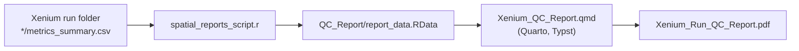

# Spatial-Reports

Generates a PDF QC report for a 10x Xenium run. For every region in the run it
summarises:

- cells detected
- total high-quality transcripts
- median genes per cell
- median transcripts per cell
- % of transcripts assigned to cells

It also flags regions whose metrics are more than 2 standard deviations from
the run mean, so they can be reviewed in Xenium Explorer.

## How it works



| File | Purpose |
|------|---------|
| `spatial_reports_script.r` | Finds every `metrics_summary.csv` in the run, builds the summary tables and outlier notes, saves `QC_Report/report_data.RData` in the run folder |
| `Xenium_QC_Report.qmd` | Quarto template that loads `report_data.RData` and lays out the PDF |

The PDF is produced with Quarto's Typst output, so no LaTeX installation is
needed.

## Requirements

- R with `dplyr`, `readr`, `purrr`, `knitr` and `rmarkdown` installed
- Quarto 1.4 or later (the first version with Typst PDF output); check with
  `quarto --version`

If you use renv, run both steps below from the renv project folder so R and
Quarto pick up the project's packages.

## Usage

### 1. Collect the metrics

```bash
Rscript spatial_reports_script.r /path/to/xenium/run_folder
```

The run folder argument is optional; without it the script uses the
`xenium_root` path set at the top of the script. This writes
`<run_folder>/QC_Report/report_data.RData`.

### 2. Render the report

```bash
quarto render Xenium_QC_Report.qmd --to typst \
  -P data_file:/path/to/xenium/run_folder/QC_Report/report_data.RData \
  -P run_name:<run_folder_name> \
  --output Xenium_Run_QC_Report.pdf
```

This writes `Xenium_Run_QC_Report.pdf` next to the `.qmd`. Move it into the
run's `QC_Report` folder if you want it kept with the data:

```bash
mv Xenium_Run_QC_Report.pdf /path/to/xenium/run_folder/QC_Report/
```

`run_name` is printed at the top of the report and can be left out.

## Troubleshooting

**"No metrics_summary.csv files found."** R could not see any
`metrics_summary.csv` under the run folder. Check from the same session:

```r
dir.exists("/path/to/xenium/run_folder")
list.files("/path/to/xenium/run_folder", pattern = "metrics_summary", recursive = TRUE)
```

If these return nothing, the folder is not readable from that session (for
example, NEMO is not mounted on that node or the region outputs have not been
transferred yet).

**"quarto: command not found" or no Typst output.** Install or load Quarto 1.4
or later (on NEMO, check `module avail quarto`).

**"there is no package called ..."** Install the missing package, e.g.
`renv::install("knitr")` in an renv project or `install.packages("knitr")`
otherwise.
